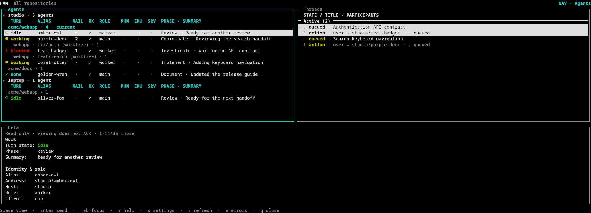
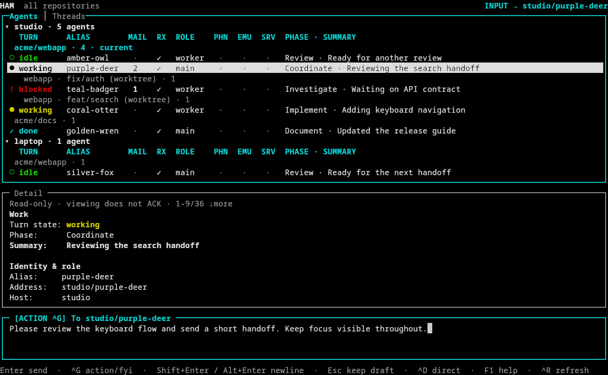
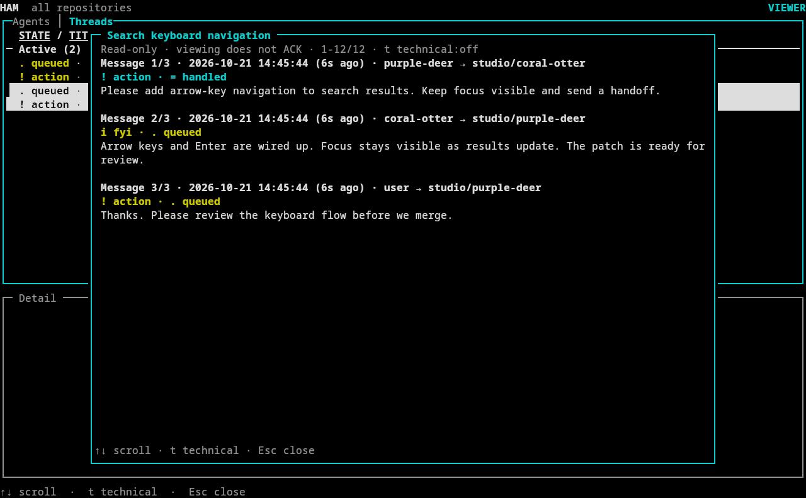
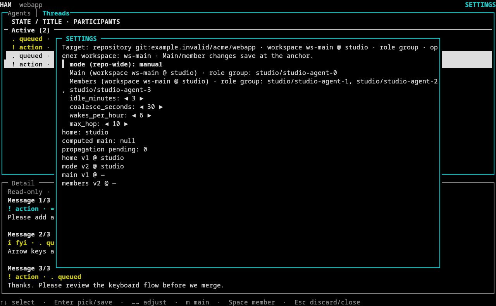
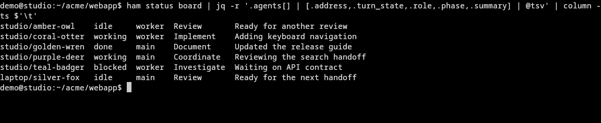

<p align="center">
  
</p>

# HAM — Herdr Agent Messenger

[한국어](README.ko.md) · English

HAM is a Herdr plugin for coordinating coding agents without losing messages
in terminal scrollback. It gives unnamed agents memorable `color-animal` labels
and a durable mailbox across repositories and registered SSH hosts, with a
keyboard-first view of who is working, what they are doing, and what needs a reply.



*Real terminal captures with fictional agents, repositories, and messages.*

## What it does

- **Durable agent mail:** send, reply, and explicitly handle threads across
  repositories and registered hosts. Delivery and completed work stay distinct.
- **Action or FYI:** eligible `action` mail wakes an idle participating OMP agent
  promptly; `fyi` is batched for a wake after about ten to fifteen minutes. FYI arriving
  during a turn is delivered right after it, under existing wake safeguards.
  CLI sends default to `fyi`.
- **Main and workers:** `off`, `manual`, and `auto` participation modes, with
  linked worktrees grouped under their main-checkout workspace. Roles and
  summaries also appear in HAM-owned Herdr borders; manual names are preserved.
- **Mailbox TUI:** browse Agents and Threads, compose action/FYI mail, reply,
  and manage participation in Settings without leaving the terminal.
- **Read-only status board:** see roles, turn states, phases, summaries, unread
  mail, and receiver health across local repositories and registered peers.
- **Resource presence:** claim phones or emulators before use and release them
  afterward; inspect discovered servers separately from device ownership.
- **Three clients:** bundled skills for omp, Claude Code, and Codex. OMP and
  Claude receiving runtimes are opt-in; Codex pulls mail at work boundaries.

## Requirements

- [Herdr](https://github.com/devswha/herdr) **0.8.0+** on each participating host.
- **Python 3.10+**; the optional SSH rollout helper requires **Python 3.11+**.
- For remote agents, working SSH aliases and registered HAM peers.
  See [SSH and routing](docs/ssh-and-routing.md).

## Install

```bash
herdr plugin install zerodice0/herdr-agent-messenger --yes
herdr plugin action invoke agent-skill-guide --plugin herdr.agent-messenger
```

Select the client skill and installation scope in **HAM Skill**. From the plugin
root, `python3 -m ham skill-installer install all` installs all user-scope
skills. Plugin and skill installation alone do not activate native receiving.

Run `runtime status` with the installed skill's CLI on every selected host.
Install an OMP or Claude runtime **only with user consent**, then restart only
selected sessions and confirm receiver activation. Codex needs no adapter.
See [receiving setup](docs/skill-guide.md#receiving-dependency).

For local links, the former repository name, or upgrades from the old
`herdr.agent-labels` plugin ID, follow [installation and migration](docs/migration.md).
The ledger schema is **v10**; the [package cutover](docs/migration.md#python-package-layout) requires all five hosts together.

## Quick start

The module examples deliberately use plugin-root cwd in a registered Herdr pane.
For caller-relative spawn/file/destination paths, use the absolute copied/bundled `scripts/herdr_agent_messenger.py` launcher from your project cwd instead.
Copy a verified board address; see [cwd guidance](docs/migration.md#python-package-layout).

```bash
python3 -m ham cli status board
python3 -m ham cli mail send \
  --to local/purple-deer --kind action --subject 'Review' \
  --body 'Review the authentication change and report concrete findings.'
```

At the recipient's work boundary, read the message and do the relevant work.
A read does not acknowledge or handle mail.

```bash
python3 -m ham cli inbox read
python3 -m ham cli inbox handle --message MESSAGE_UUID
python3 -m ham cli mail send \
  --to local/blue-otter --reply-to MESSAGE_UUID --kind fyi \
  --body 'Review complete: no blocking findings.'
```

A reply also handles its addressed parent atomically, so a separate `inbox handle`
is unnecessary when replying. Choose `--kind action` if the recipient must act,
answer, or continue; use `fyi` for reference information.
Use `--to main` for your role group's main, or `[HOST/]main@REPO` for another
repository's unique main, such as `studio/main@acme/webapp`.

Publish your current phase and a short summary; phase is not the Herdr turn state:

```bash
python3 "$HAM_CLI" status set review --summary 'Reviewing authentication changes'
herdr plugin action invoke mailbox-tab --plugin herdr.agent-messenger
```

You can also open **HAM: Mailbox (Right Split)** or **HAM: Mailbox (quick send)**
from Herdr's command palette. Only the user changes mode, main, members, and
wake thresholds: use Settings, or `m` on an Agents row to pin/unpin main. New repositories default to `auto`; existing
settings are preserved. See [roles and participation](docs/skill-guide.md#modes-roles-and-public-status).

Quick send, **Send Prompt to Agents**, **Held Messages**, and **HAM Skill** use
Herdr overlays: temporary zoomed panes that restore the previous focus and zoom
when closed. HAM does not set their width or height; Herdr 0.8.0+ remains supported.
See the [overlay behavior and source references](docs/ui-reference.md#herdr-overlay-placement).

## Mailbox TUI

Select an agent to compose mail or a thread to reply. Each new compose starts
as `action`; the `[ACTION ^G]` chip shows the current kind.



| Key | In the mailbox |
| --- | --- |
| `Enter` | Compose on an agent, reply on a thread, or send while typing. |
| `Ctrl+G` | Toggle `action` / `fyi` for the current compose. |
| `Shift+Enter` / `Alt+Enter` | Insert a newline; use Alt+Enter on Moshi/mosh. |
| `Tab` / `Shift+Tab` | Move between regions in navigation mode. |
| `m` | Agents: confirm pinning the selected live local role-group agent as main, or clear its explicit pin. |
| `s` | Open Settings in navigation mode. |
| `?` / `F1` | Open help in navigation mode / while typing. |
| `Esc` | Leave input while retaining the draft. |

Shift+Enter uses the requested kitty keyboard protocol in compatible terminals;
Ctrl+J is not a newline key. `HAM_MAILBOX_NO_KITTY=1` disables the request.

Threads keep the question and replies together. Viewing them never ACKs mail.



Settings controls repository participation and host-local main/worker membership.
Linked worktrees inherit their anchor workspace's role settings while grouped.



For direct user input, operator recovery, diagnostics, all keys, and responsive
layouts, see the [UI reference](docs/ui-reference.md). Direct input requires
confirmation, may interrupt an agent, and is not native mailbox delivery.

## Status board

```bash
python3 "$HAM_CLI" status board
python3 "$HAM_CLI" status board --repo --host local
```



The default board includes all local repositories and registered peers. Bare
`--repo` selects the caller's repository; `--host` narrows the host. Add
`--verbose` for full diagnostics. A peer failure can still return exit code 0:
inspect host errors, stale flags, and unread `?`, not just the command's exit code.
Board reads do not refresh status, registry entries, or device claims.

## Documentation

| Topic | English | 한국어 |
| --- | --- | --- |
| Skills, mail, roles, runtimes, and CLI workflows | [Skill guide](docs/skill-guide.md) | [스킬 가이드](docs/ko/skill-guide.md) |
| Installation, schema upgrades, and old plugin IDs | [Migration](docs/migration.md) | [마이그레이션](docs/ko/migration.md) |
| Mailbox, Settings, keys, and recovery | [UI reference](docs/ui-reference.md) | [UI 참고서](docs/ko/ui-reference.md) |
| SSH discovery and routing safety | [SSH and routing](docs/ssh-and-routing.md) | [SSH 및 라우팅](docs/ko/ssh-and-routing.md) |
| Safe remote deployment and rollback | [Rollout](docs/rollout.md) | [원격 배포](docs/ko/rollout.md) |

For exhaustive flags and receipt semantics, read the bundled
[command reference](.agents/skills/herdr-agent-messenger/reference.md).
New sessions use one `spawn --message` operation, not spawn followed by a legacy
request; see [session creation](docs/skill-guide.md#start-a-new-labeled-session).
For host onboarding, follow the [deployment order](docs/skill-guide.md#opt-in-runtime-installation-and-deployment-order)
before enabling participation. [Standalone setup](docs/skill-guide.md#use-ham-without-the-plugin)
also supports Herdr without enabling the plugin, with documented limitations.

## Test

```bash
python3 -m unittest discover -s tests -t .
bun test tests/omp_mailbox_runtime.test.ts
```

Tests use private HOME/XDG or ledger fixtures; see
[test isolation](docs/skill-guide.md#test-isolation) before adding fixtures.
